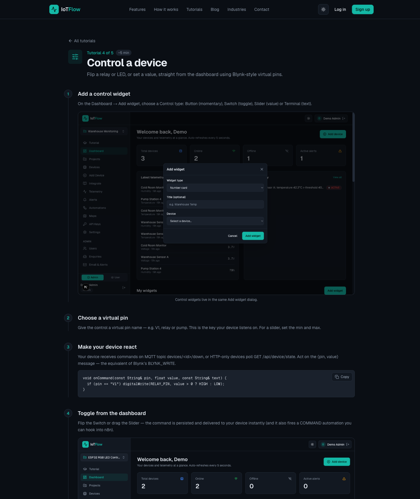

# Lab 3 — Read Data Back and Remotely Control the Asset

**Course:** Business Innovation with Internet-of-Things (IoT) (TGS-2026064711)  
**Topic 03:** IoT Technology  
**Objective:** Close the loop between cloud data and physical action — the basis of an IoT business process (A3, K2).  
**Platform:** IoTFlow — https://iot.tertiaryinfotech.com

## Goal

Read device state back out of the cloud over the REST API and MQTT, then add Control widgets (switch, slider) bound to virtual pins and drive the device from the dashboard. Reading data is monitoring; sending commands back is automation — and that is where the labour savings appear.

## What you'll build

A dashboard switch and slider that control a relay/LED on the device in real time

*Uses: REST API (GET /api/device/state) · MQTT subscribe · Control widgets · Virtual pins · @on_command.*



## Why the business cares

Monitoring tells you what happened. Control lets the system act without a person driving out to the site — this is usually the single largest line in an IoT cost-benefit case.

## Prerequisites

- A free account on IoTFlow (https://iot.tertiaryinfotech.com).
- A modern browser. IoT hardware (ESP32/ESP8266) is optional — every lab can be completed with cURL or Python from any terminal.
- Your device token from Lab 1 (`dev_...`).
- Python 3 for the scripted steps — see Setup below.

## Setup (once for all labs)

```bash
pip install -r ../requirements.txt   # installs iotflow[mqtt]
cp ../config.example.py ../config.py  # then paste your device token
```

`config.py` holds your device token, so you paste it once and every lab script picks it up. It is git-ignored and never committed.

## Scripts in this folder

| Script | What it does |
|---|---|
| [`control_http.py`](control_http.py) | Reacts to the dashboard's Switch and Slider widgets. |
| [`control_mqtt.py`](control_mqtt.py) | The same @on_command handler as control_http.py, but delivered over MQTT. |
| [`read_state.py`](read_state.py) | Reads your device's current virtual-pin state back out of IoTFlow with state(). |

Run them from inside this folder, e.g.:

```bash
cd lab-03
python control_http.py
```

## Step-by-step

### Step 1 — Read your device's latest state from any terminal over the REST API, and inspect the JSON reply — the platform returns the current value of every metric and virtual pin.

```bash
curl https://iot.tertiaryinfotech.com/api/device/state \
  -H "Authorization: Bearer dev_XXXXXXXXXXXX"
```

### Step 2 — Subscribe to your device's MQTT downlink topic to watch commands and data arrive in real time. Note the direction: uplink is telemetry, downlink is commands.

```bash
mosquitto_sub -h iot.tertiaryinfotech.com -p 1883 \
  -u device -P dev_XXXXXXXXXXXX -t "devices/<id>/down" -v
```

### Step 3 — On the Dashboard click Add widget and choose a Control type: Button (momentary), Switch (toggle), Slider (value) or Terminal (text).

### Step 4 — Assign the virtual pin the widget writes to — for example V1, relay or pump. For a slider also set the min/max range.

```bash
Virtual pin:  V1
```

### Step 5 — React to commands in Python with the iotflow client. Decorate a handler with @iot.on_command and poll over HTTP — no extra dependencies needed.

```bash
from iotflow import IoTFlow

iot = IoTFlow("https://iot.tertiaryinfotech.com", "dev_XXXXXXXXXXXX", "cold-room-sensor-01")

@iot.on_command
def handle(pin, value, text):
    if pin == "V1":
        print("relay ->", value)      # drive a GPIO here

iot.run(interval=3)                   # blocks, polls every 3 s
```

### Step 6 — For real-time control use the same handler over MQTT — loop_forever() keeps the connection open so commands arrive instantly instead of on the next poll.

```bash
iot = IoTFlow(token="dev_XXXXXXXXXXXX", device_id="cold-room-sensor-01",
              mqtt_host="iot.tertiaryinfotech.com", mqtt_port=1883)

@iot.on_command
def handle(pin, value, text): ...

iot.loop_forever()
```

### Step 7 — Flip the switch and drag the slider on the dashboard. Commands are delivered to the device immediately and the relay/LED responds. The same events can also trigger automations (Lab 4).

## Test it

Toggling the dashboard switch changes the relay/LED state within a second, and the slider value arrives in your @on_command handler as you drag it.

---
*© 2026 Tertiary Infotech Academy Pte Ltd. All rights reserved. · www.tertiarycourses.com.sg*
