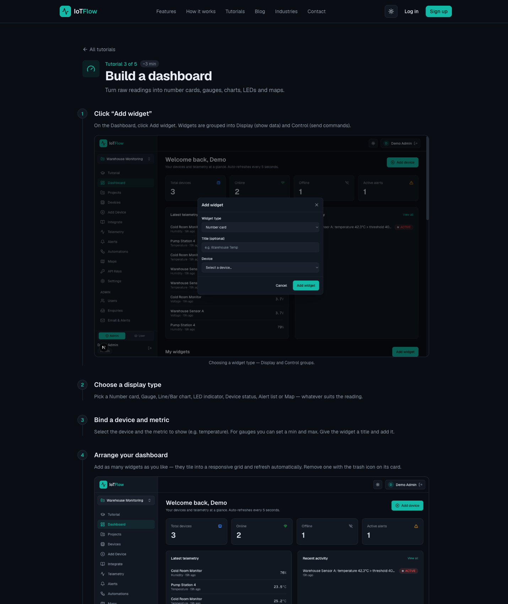

# Lab 4 — Turn IoT Data into Business Insight

**Course:** Business Innovation with Internet-of-Things (IoT) (TGS-2026064711)  
**Topic 03:** IoT Technology  
**Objective:** Use analytics, visualisation and automation to turn raw telemetry into a business decision (A3, K2).  
**Platform:** IoTFlow — https://iot.tertiaryinfotech.com

## Goal

Build a live dashboard from your readings — number cards, gauges, charts, LED indicators and maps — then set a threshold alert and hand it to an n8n workflow that notifies the team, logs the event and asks an AI node to summarise the readings and recommend an action.

## What you'll build

A monitoring dashboard plus an alert-driven n8n workflow with an AI summary and a downlink command

*Uses: Display widgets · Alert rules · IoTFlow Automations · n8n Webhook · Email/Telegram · Google Sheets · AI nodes.*



## Why the business cares

This is the slide the board actually sees. A dashboard makes performance visible, an alert makes it timely, and the AI summary turns a stream of numbers into a recommended action.

## Prerequisites

- A free account on IoTFlow (https://iot.tertiaryinfotech.com).
- A modern browser. IoT hardware (ESP32/ESP8266) is optional — every lab can be completed with cURL or Python from any terminal.
- Your device token from Lab 1 (`dev_...`).
- Python 3 for the scripted steps — see Setup below.

## Setup (once for all labs)

```bash
pip install -r ../requirements.txt   # installs iotflow[mqtt]
cp ../config.example.py ../config.py  # then paste your device token
```

`config.py` holds your device token, so you paste it once and every lab script picks it up. It is git-ignored and never committed.

## Scripts in this folder

| Script | What it does |
|---|---|
| [`closed_loop.py`](closed_loop.py) | Runs the full IoT business loop — sense, decide, act, verify — on one device in one file. |
| [`simulate_breach.py`](simulate_breach.py) | Drives a temperature excursion on purpose so you can watch your alert pipeline fire end to end. |

Run them from inside this folder, e.g.:

```bash
cd lab-04
python closed_loop.py
```

## Step-by-step

### Step 1 — On the Dashboard click Add widget. Widgets are grouped into Display (show data) and Control (send commands). Add a Number card for temperature and give it a clear title.

### Step 2 — Add a Gauge for humidity with sensible min/max bounds (0–100 %), then a Line chart to plot the temperature history over time.

### Step 3 — Add an LED indicator for on/off state, and a Map widget if your device reports a location. Arrange the layout — widgets snap to a responsive grid and refresh automatically.

### Step 4 — Create an alert rule on a business-meaningful threshold — the point at which someone would need to act.

```bash
Alert rule:  temperature > 30  →  fire automation
```

### Step 5 — In n8n, add a Webhook node to a new workflow, activate the workflow and copy the Production URL.

### Step 6 — Back in IoTFlow, create an Automation, choose the trigger type (telemetry received, alert fired, device online/offline, or command sent), optionally narrow it by device and metric, then paste the n8n webhook URL and save.

### Step 7 — Use Test to send a sample payload to n8n and inspect the JSON the webhook receives, then enable live triggering.

### Step 8 — In n8n, branch the flow: send an Email/Telegram notification and append the reading to Google Sheets so the event is both escalated and recorded.

### Step 9 — Add an AI node that summarises the recent readings and recommends an action — analytics with no code, and the output a manager can read.

### Step 10 — Close the loop: add an HTTP Request node that sends a downlink command back to the device, for example switching a fan or compressor on.

```bash
POST https://iot.tertiaryinfotech.com/api/device/command
{ "pin": "V1", "value": 1 }
```

## Test it

Pushing a reading above the threshold fires the n8n workflow: the notification arrives, a row is appended to the sheet, the AI summary is generated, and the device reacts to the command sent back.

---
*© 2026 Tertiary Infotech Academy Pte Ltd. All rights reserved. · www.tertiarycourses.com.sg*
